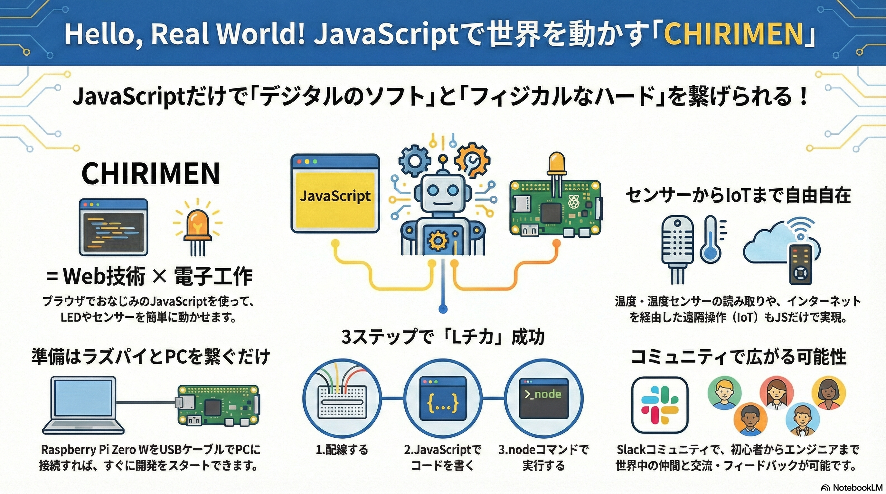
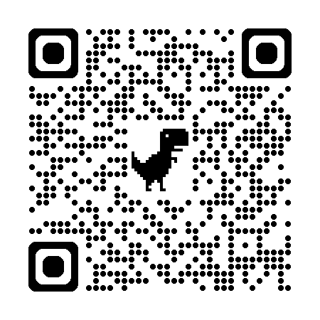
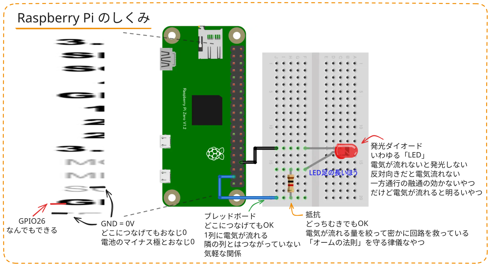
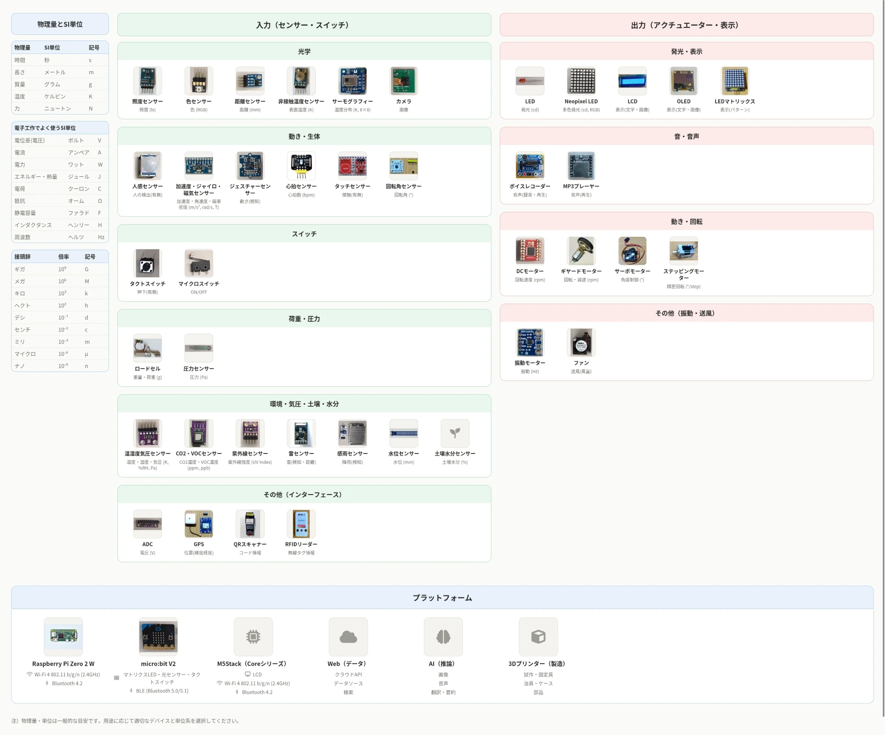
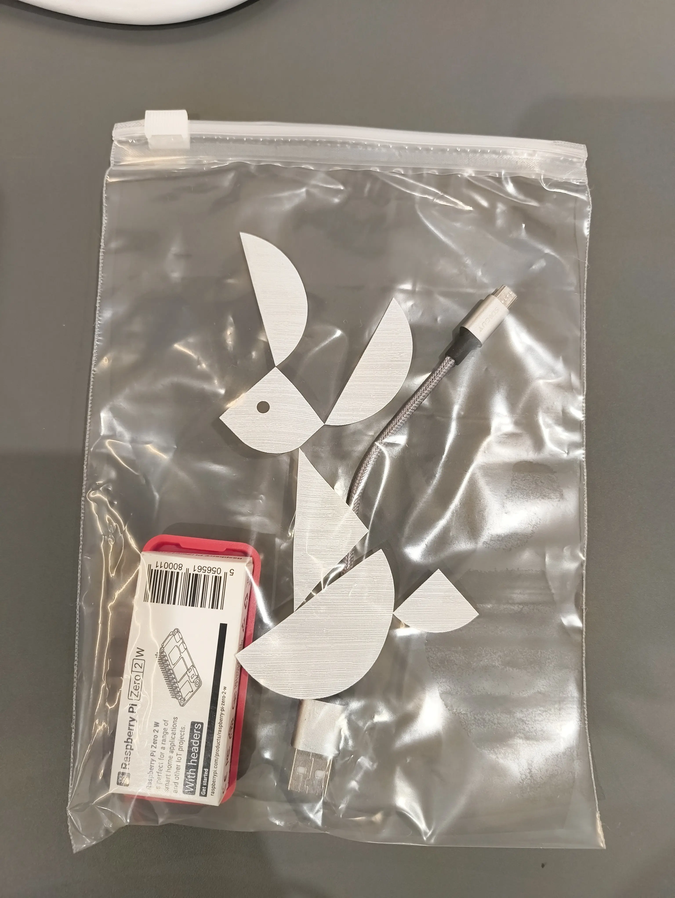

# 2026-11-14 ワークショップ

---

# デジタルものづくり<br>IoT 体験ワークショップ

島根県立安来高等学校 やすぎ Lab-I

WebDINO Japan エンジニア
[渡邉浩平](https://scrapbox.io/intro-to-web-dev/watanabe)

むずかしい言葉が出てきたら、お気軽にご質問ください :relaxed:

<!-- _paginate: false -->
<!-- _footer: "  © 2026 渡邉浩平 [CC BY 4.0](https://creativecommons.org/licenses/by/4.0/deed.ja)" -->

---

## プロフィール


**<ruby>渡邉<rt>わたなべ</rt></ruby><ruby>浩平<rt>こうへい</rt></ruby>**
一般社団法人 WebDINO Japan エンジニア

1992 年生まれ。岡山県<ruby>総社市<rt>そうじゃし</rt></ruby>出身。鳥取大学工学部卒。
2019 年から WebDINO Japan で、Web の仕事をしています。
OSSを組み合わせてコンピューターで遊ぶのが好きです。

---



<!-- NOTE: 10-20年前は難しいプログラミングが必要でしたが、今はJavaScriptから簡単に作れるようになりました。 -->
<!-- NOTE: 具体的にはWeb GPIO APIやWeb I2C APIと呼ばれるオープンな仕様に支えられているオープンソースソフトウェアです。 -->

---

## 本日のゴール

**となりの人のために、ひとつ作る**

<div class="steps">
<div class="step s1 pop" style="--i:0"><span class="num">1</span><span class="ttl">動かす</span><span class="sub">見本を配線する</span></div>
<span class="arr">▶</span>
<div class="step s2 pop" style="--i:1"><span class="num">2</span><span class="ttl">聞く</span><span class="sub">相手の困りごとを聞く</span></div>
<span class="arr">▶</span>
<div class="step s3 pop" style="--i:2"><span class="num">3</span><span class="ttl">作って試す</span><span class="sub">相手のために改造する</span></div>
</div>

<!-- NOTE: 上手に作ることより、相手に試してもらって直すことを何回もやるのが今日の中心です。 -->

---

## 本日の流れ

<ul class="tl">
<li><time>10:30</time>はじめに</li>
<li class="s1"><time>10:45</time><b>① 動かす</b> セットアップ・LED を光らせる</li>
<li class="rest"><time>12:00</time>昼休み</li>
<li class="s1"><time>13:00</time><b>① 動かす</b> (つづき) センサーを読む</li>
<li class="s2"><time>13:45</time><b>② 聞く</b></li>
<li class="s3"><time>14:15</time><b>③ 作って試す</b> (途中で休憩)</li>
<li class="s3"><time>16:00</time>みんなに共有</li>
<li><time>16:30</time>終了・片付け</li>
</ul>

---

## CHIRIMEN チュートリアル資料



https://chirimen.org/pizero/ にアクセス

または [chirimen pizero で検索 🔍](https://www.google.com/search?q=chirimen+pizero)

---

## 困ったとき・分からないとき

手を挙げて、近くのスタッフに声をかけてください :relaxed:

となりの人に聞いても OK

---

<!-- class: s1 -->
<!-- header: "**① 動かす** ▸ ② 聞く ▸ ③ 作って試す" -->
<!-- _class: chapter s1 -->

# 動かす

見本を配線して動かす

---

## 用意するもの


<!-- _footer: https://chirimen.org/pizero/chapter_2-1 -->

---

## Raspberry Pi Zero の起動


1. microSD カードを差し込む
1. 専用ケースに入れる (オプション)
1. パソコンと USB ケーブルで接続する

---

## ターミナルに接続

https://chirimen.org/PiZeroWebSerialConsole/PiZeroWebSerialConsole.html


1. ターミナルにアクセス
2. [Connect and Login PiZero] を選択
3. [接続]


このような画面が出たら「接続」をクリック ✅

<!-- _footer: https://chirimen.org/pizero/chapter_2-2 -->

---

## Wi-Fi の設定

1. [wifi panel] > [SSID] [PASS PHRASE] を入力
2. [SET WiFi] を選択
3. [wifi Info] を選択して接続を確認

- 青字で "Raspberry Pi's IP Address: \*\*\*" が出たら OK ✅
- "Fail to connect chirimen.org." が出たら NG ❌
- もう一度 1. からやり直す

---

## フリーズしたときは再起動

1. USB ケーブルを抜く (電源 OFF)
1. (もう一度) USB ケーブルを接続して起動
1. ターミナルの画面をリロード (🔁 ボタン・`Ctrl`+`R`・`F5` キーなど)
1. [Connect and Login PiZero] を選択
   - シリアルポートが表示されていれば OK ✅

- 起動完了まで約 2 分かかります

1. (もう一度) [接続]

<!-- _footer: https://chirimen.org/pizero/chapter_2-3 -->

---

## ブレッドボードでの配線

https://chirimen.org/pizero/chapter_3-1

---



---

## プログラムを書く

[myApp] > [移動] > [Create New Text] > "hello.js" と入力

```js
import { requestGPIOAccess } from "node-web-gpio"; // WebGPIO を使えるようにするためのライブラリをインポート
const sleep = (ms) => new Promise((resolve) => setTimeout(resolve, ms)); // sleep 関数を定義

const gpioAccess = await requestGPIOAccess(); // GPIO を操作する
const port = gpioAccess.ports.get(26); // 26 番ポートを操作する

await port.export("out"); // ポートを出力モードに設定

// 無限ループ
while (true) {
  // 1秒間隔で LED が点滅します
  await port.write(1); // LEDを点灯
  await sleep(1000); // 1000 ms (1秒) 待機
  await port.write(0); // LEDを消灯
  await sleep(1000); // 1000 ms (1秒) 待機
}
```

コピー&ペースト > [Save] (保存)

---

## プログラムの実行

"hello.js" を実行する方法

```
node hello.js
```

止めるには `Ctrl`+`C`

書式:

```
node [ファイル名]
```

---

## サンプルコードのダウンロード

CHIRIMEN panel > Get Examples > hello-real-world (L チカ) > JS GET

ほかのサンプルコードや配線図を見られます

---

## 数字を変えてみよう

"hello.js" の `1000` を `200` に書き換える > [Save] > もう一度実行

```js
await sleep(200); // 200 ms (0.2秒) 待機
```

<div class="leds">
<span><i class="led slow"></i><code>1000</code> ゆっくり</span>
<span class="arr">▶</span>
<span><i class="led fast"></i><code>200</code> 速い</span>
</div>

---

## ここまでのまとめ

- Raspberry Pi Zero のセットアップ
- LED を制御するプログラム (通称 LED チカチカ、L チカ) の実行
- 数字を変えて改造

---

<!-- _class: chapter -->
<!-- _header: "" -->

# 〜昼休み〜

13:00 に再開

---

## 見本を増やす

| 見本 | できること | 資料 |
| --- | --- | --- |
| 温湿度センサー (SHT30) | 温度・湿度をはかる | [I2C デバイスを試す](https://chirimen.org/pizero/chapter_5.html) |
| 温湿度センサー + LED | 決まった温度で光らせる | [組み合わせる](https://chirimen.org/pizero/chapter_5-4.html) |
| スイッチ・モーター | 押されたことを知る・回す | [GPIO を試す](https://chirimen.org/pizero/chapter_4.html) |
| 遠隔 LED | スマホから光らせる | [IoT を試す](https://chirimen.org/pizero/chapter_6.html) |

全員で温湿度センサー。終わった人はほかの見本へ

---

## 温湿度センサーを動かす

1. [CHIRIMEN Panel] > [Get Examples] を選択
2. ID: `sht30` を探す
3. 回路図のとおりに配線する
4. [i2c detect] でセンサーが見えているか確かめる
5. [JS GET] でコードを取得して実行する

```
node main-sht30.js
```

センサーを指であたためて、数字の変化を見る

<!-- _footer: https://chirimen.org/pizero/chapter_5-2.html -->

---

## 手もとにある部品

<div class="steps">
<div class="step in pop" style="--i:0"><span class="ttl">入力</span><span class="sub">まわりの様子を知る</span><span class="chips"><span>🔘 スイッチ</span><span>🌡️ 温度・湿度</span><span>☀️ 明るさ</span><span>📏 距離</span><span>🚶 人の動き</span></span></div>
<span class="arr">▶</span>
<div class="step mid pop" style="--i:1"><span class="ttl">プログラム</span><span class="sub">「もし〜なら」を決める</span></div>
<span class="arr">▶</span>
<div class="step out pop" style="--i:2"><span class="ttl">出力</span><span class="sub">はたらきかける</span><span class="chips"><span>💡 LED</span><span>🌀 モーター</span><span>🦾 サーボモーター</span><span>🌈 カラー LED</span></span></div>
</div>

応用センサーセットは共有 / [使い方](https://chirimen.org/pizero/chapter_8-1)

---



<!-- _backgroundColor: #fff -->
<!-- _backgroundImage: none -->
<!-- _header: "" -->
<!-- _footer: 参考: https://chirimen.org/partslist -->

---

<!-- class: s2 -->
<!-- header: "① 動かす ▸ **② 聞く** ▸ ③ 作って試す" -->
<!-- _class: chapter s2 -->

# 聞く

ペアで困りごとを聞き、相手の望みをまとめる

---

## ペアで交互に聞く

5 分ずつ交代

<p class="bubble pop">「最近、ちょっと面倒なこと・困ったことは？」<small>学校・家・部活・通学、なんでも OK</small></p>

聞く人の約束

- 解決策を言わない
- 「たとえばいつ？」「どうして？」と聞く
- 相手の言葉のままメモする

<!-- NOTE: 人数が奇数のときは 3 人組にして、A→B、B→C、C→A の順で聞く。 -->

---

## 相手の望みをまとめる

**動詞ひとつ**で書く

> ◯◯さんは、＿＿＿＿ **したい**

- 忘れ物に **気づきたい**
- 部屋が暑くなったら **知りたい**
- 朝、ちゃんと **起きたい**

相手に見せて確かめる

---

## 望みを「しくみ」にする

<p class="wish">例: 部屋が暑くなったら <b>知りたい</b></p>
<div class="steps small">
<div class="step in pop" style="--i:0"><span class="ttl">入力</span><span class="ico">🌡️</span><span class="sub">温度センサー</span></div>
<span class="arr">▶</span>
<div class="step mid pop" style="--i:1"><span class="ttl">条件</span><span class="ico">❓</span><span class="sub">28℃ 以上なら</span></div>
<span class="arr">▶</span>
<div class="step out pop" style="--i:2"><span class="ttl">出力</span><span class="ico">💡</span><span class="sub">LED が点滅</span></div>
</div>

出発点は見本 `sht30_led`

---

<!-- class: s3 -->
<!-- header: "① 動かす ▸ ② 聞く ▸ **③ 作って試す**" -->
<!-- _class: chapter s3 -->

# 作って試す

相手のために改造 → 試してもらう → 手を入れる

---

## 何周でも回す

<div class="loop">
<div class="node" style="--i:0; grid-area:a"><b>作る</b><small>見本を改造</small></div>
<span class="arr" style="grid-area:ab">▶</span>
<div class="node" style="--i:1; grid-area:b"><b>試してもらう</b><small>相手が使う</small></div>
<span class="arr" style="grid-area:bc">▼</span>
<div class="node" style="--i:2; grid-area:c"><b>書いてもらう</b><small>＋／−／？／！</small></div>
<span class="arr" style="grid-area:cd">◀</span>
<div class="node" style="--i:3; grid-area:d"><b>手を入れる</b><small>書かれたことをもとに</small></div>
<span class="arr" style="grid-area:da">▲</span>
</div>

**できかけ**で見せる

---

## ＋／−／？／！

試した人が紙に書く

<div class="pmqe">
<div class="plus pop" style="--i:0"><b>＋</b> よかった</div>
<div class="minus pop" style="--i:1"><b>−</b> いまいち</div>
<div class="ques pop" style="--i:2"><b>？</b> わからなかった</div>
<div class="excl pop" style="--i:3"><b>！</b> ひらめいた</div>
</div>

作った人は説明しない。使う様子を見る

---

## 作るときのコツ

- 最初の 1 周は 15 分
- コピー&ペースト OK、まね OK
- 数字 (何℃・何秒) は相手と決める
- 見た目は紙や段ボールで OK
- 動かなくても見せる

---

## AI アシスタントに聞く

https://deepwiki.com/chirimen-oh/chirimen-deepwiki

部品の名前と、やりたい動きを具体的に書く

- 「SHT30 で温度を取得して、28 度を超えたら GPIO 26 の LED を点滅させるコードを書いて」
- 「このエラーの意味を教えて：(エラーメッセージを貼り付ける)」

AI はまちがえることもある。配線は自分の目で確かめる

<!-- _footer: https://chirimen.org/pizero/using-ai-assistant -->

---

## みんなに共有

1 人 2 分

1. 相手の望み
2. 動かして見せる
3. ＋／−／？／！ で変えたところ

---

<!-- class: "" -->
<!-- header: "" -->

## ⚠ 片付け

使った機材を元にもどしましょう



- Raspberry Pi・USB ケーブル
- SD カード (抜き忘れに注意)
- スターターキット・応用センサーセットの中身

---

## これから

- [CHIRIMEN チュートリアル](https://chirimen.org/pizero/)
- [CHIRIMEN 対応デバイスの一覧](https://chirimen.org/partslist)
- [Web×IoT メイカーズチャレンジ 作品ギャラリー](https://webiotmakers.github.io/gallery/)

---

## 配布プリント

- [ワークシート](./print/worksheet.pdf) (A4 両面・1 人 1 枚)
- [部品の一覧](./print/parts.pdf) (A4 横)
- [早見表](./print/cheatsheet.pdf) (A4 両面)

---

## 過去の資料

- [2026 年度 秋田版](/chirimen-hands-on/2026/akita/)
- [2026 年度 岡山版](/chirimen-hands-on/2026/okayama/)
- [2025 年度 徳島版](/chirimen-hands-on/2025/tokushima/)
- [2025 年度 三重版](/chirimen-hands-on/2025/mie/)
- [2023 年度 岡山版](/chirimen-hands-on/2023/okayama/)
- [2022 年度 東京版](/chirimen-hands-on/2022/tokyo/)
- [2022 年度 岡山版](/chirimen-hands-on/2022/okayama/)
- [2022 年度 愛媛版](/chirimen-hands-on/2022/ehime/)

---

## フィードバック

[このスライドを編集する](https://github.com/kou029w/chirimen-hands-on/edit/main/README.md) / [問題を報告する](https://github.com/kou029w/chirimen-hands-on/issues/new)


<small class="tm">© 2026 渡邉浩平 / この資料は [CC BY 4.0](https://creativecommons.org/licenses/by/4.0/deed.ja) で利用できます (ロゴを除く)</small>
<small class="tm">WebDINO のロゴは一般社団法人 WebDINO Japan の登録商標です (商標登録第 6056882 号)</small>

<script type="module">
document.querySelectorAll("a").forEach(function (a) {
  Object.assign(a, {
    target: "_blank",
    rel: "noreferrer",
  });
});
</script>

<style>
@import url("https://fonts.googleapis.com/css2?family=Baloo+2:wght@600;700&family=Zen+Maru+Gothic:wght@500;700&display=swap");

:root {
  --bg: #fffaf0;
  --ink: #1f2a44;
  --sun: #ffd54f;
  --sky: #90caf9;
  --leaf: #a5d6a7;
  --coral: #ff8a65;
}

section {
  font-family: "Zen Maru Gothic", "Baloo 2", sans-serif;
  color: var(--ink);
  background:
    radial-gradient(circle at 8% 12%, rgba(255, 213, 79, 0.35) 0 180px, transparent 181px),
    radial-gradient(circle at 92% 18%, rgba(144, 202, 249, 0.35) 0 160px, transparent 161px),
    radial-gradient(circle at 12% 85%, rgba(165, 214, 167, 0.35) 0 170px, transparent 171px),
    radial-gradient(circle at 88% 88%, rgba(255, 138, 101, 0.35) 0 150px, transparent 151px),
    repeating-linear-gradient(45deg, rgba(31, 42, 68, 0.03) 0 8px, rgba(31, 42, 68, 0.01) 8px 16px),
    var(--bg);
  padding: 0 1.25rem;
  --step: var(--sun);
}

/* 章ごとの色: ① 黄 ② 青 ③ 緑 */
section.s1, .s1 { --step: var(--sun); }
section.s2, .s2 { --step: var(--sky); }
section.s3, .s3 { --step: var(--leaf); }

/* 現在地 (右上) */
footer img {
  vertical-align: middle;
  margin-right: 0.5rem;
}

header {
  left: auto;
  right: 1.25rem;
  top: 0.6rem;
  font-size: 0.55rem;
  color: rgba(31, 42, 68, 0.55);
  background: rgba(255, 255, 255, 0.8);
  border-radius: 99rem;
  padding: 0.15rem 0.6rem;
}

section header strong {
  color: var(--ink);
  background: var(--step);
  border-radius: 99rem;
  padding: 0.05rem 0.5rem;
}

/* 章扉 */
section.chapter {
  align-items: center;
  text-align: center;
}

section.chapter header {
  display: none;
}

section.chapter::before {
  display: grid;
  place-items: center;
  width: 7rem;
  height: 7rem;
  margin: 0 auto 1rem;
  border-radius: 50%;
  background: var(--step);
  box-shadow: 0.3rem 0.3rem 0 rgba(31, 42, 68, 0.15);
  font: 700 4.5rem/1 "Baloo 2", sans-serif;
  animation: pop 0.5s ease-out both;
}

section.chapter.s1::before { content: "1"; }
section.chapter.s2::before { content: "2"; }
section.chapter.s3::before { content: "3"; }

section.chapter h1 {
  font-size: 3rem;
}

/* 横にならぶカード (3 ステップ、入力 → 出力) */
.steps {
  display: flex;
  align-items: stretch;
  gap: 0.5rem;
  margin: 0.75rem 0;
}

.step {
  flex: 1;
  display: flex;
  flex-direction: column;
  align-items: center;
  gap: 0.25rem;
  padding: 0.75rem 0.5rem;
  border-top: 0.5rem solid var(--step);
  border-radius: 0.75rem;
  background: rgba(255, 255, 255, 0.9);
  box-shadow: 0.25rem 0.25rem 0 rgba(31, 42, 68, 0.12);
  text-align: center;
}

.step.in { --step: var(--sky); }
.step.mid { --step: var(--sun); }
.step.out { --step: var(--coral); }

.step .num {
  display: grid;
  place-items: center;
  width: 2rem;
  height: 2rem;
  border-radius: 50%;
  background: var(--step);
  font: 700 1.3rem/1 "Baloo 2", sans-serif;
}

.step .ico { font-size: 2.4rem; line-height: 1.2; }
.step .ttl { font-size: 1.3rem; font-weight: 700; }
.step .sub { font-size: 0.75rem; line-height: 1.4; }
.steps.small .step .ico { font-size: 1.8rem; }
.steps.small .step .ttl { font-size: 1rem; }
.steps.small .step .sub { font-size: 0.9rem; }

.chips {
  display: flex;
  flex-wrap: wrap;
  justify-content: center;
  gap: 0.3rem;
}

.chips span {
  padding: 0.1rem 0.6rem;
  border: 0.125rem solid var(--step);
  border-radius: 99rem;
  background: #fff;
  font-size: 0.8rem;
}

.arr {
  align-self: center;
  justify-self: center;
  color: rgba(31, 42, 68, 0.4);
  font-size: 1.2rem;
}

.wish {
  margin: 0.5rem 0 0;
}

.tm {
  display: block;
  font-size: 0.5rem;
  color: rgba(31, 42, 68, 0.6);
}

/* 時間割 */
.tl {
  list-style: none;
  margin: 0.5rem 0;
  padding: 0;
}

.tl li {
  margin: 0.2rem 0;
  padding: 0.1rem 0.75rem;
  border-left: 0.6rem solid rgba(31, 42, 68, 0.15);
  border-radius: 0.4rem;
  background: rgba(255, 255, 255, 0.75);
  font-size: 0.95rem;
}

.tl li[class] { border-left-color: var(--step); }
.tl li.rest { border-left-color: transparent; background: none; color: rgba(31, 42, 68, 0.6); }

.tl time {
  display: inline-block;
  width: 4rem;
  font: 600 1rem "Baloo 2", sans-serif;
}

/* LED の点滅 */
.leds {
  display: flex;
  align-items: center;
  gap: 1.5rem;
  margin: 0.5rem 0;
}

.leds > span {
  display: flex;
  align-items: center;
  gap: 0.5rem;
}

.led {
  width: 1.4rem;
  height: 1.4rem;
  border-radius: 50%;
  background: #ff5252;
  box-shadow: 0 0 0.75rem #ff5252;
}

.led.slow { animation: blink 2s steps(1) infinite; }
.led.fast { animation: blink 0.4s steps(1) infinite; }

/* 吹き出し */
.bubble {
  position: relative;
  width: fit-content;
  margin: 0.5rem 0 1rem;
  padding: 0.6rem 1.2rem;
  border: 0.2rem solid var(--step);
  border-radius: 1.2rem;
  background: #fff;
  font-size: 1.2rem;
  font-weight: 700;
}

.bubble::after {
  content: "";
  position: absolute;
  left: 2rem;
  bottom: -0.75rem;
  width: 1.2rem;
  height: 1.2rem;
  border: solid var(--step);
  border-width: 0 0.2rem 0.2rem 0;
  background: #fff;
  transform: rotate(45deg);
}

.bubble small {
  display: block;
  font-size: 0.75rem;
  font-weight: 500;
}

/* ぐるぐる回す図 */
.loop {
  display: grid;
  grid-template:
    "a  ab  b" auto
    "da hub bc" 3rem
    "d  cd  c" auto / 1fr 4rem 1fr;
  gap: 0.25rem;
  width: 85%;
  margin: 0.5rem auto;
}

.loop .node {
  padding: 0.6rem 0.5rem;
  border: 0.2rem solid var(--step);
  border-radius: 0.75rem;
  background: #fff;
  text-align: center;
  animation: spot 8s linear infinite;
  animation-delay: calc(var(--i) * 2s);
}

.loop .node b { display: block; font-size: 1.2rem; }
.loop .node small { font-size: 0.7rem; }

/* ＋／−／？／！ */
.pmqe {
  display: grid;
  grid-template-columns: 1fr 1fr;
  gap: 0.4rem;
  width: 80%;
  margin: 0.5rem auto;
}

.pmqe div {
  height: 5rem;
  padding: 0.3rem 0.8rem;
  border-radius: 0.6rem;
  background: color-mix(in srgb, var(--c) 35%, #fff);
  border: 0.15rem solid var(--c);
}

.pmqe b { font: 700 1.8rem/1 "Baloo 2", sans-serif; margin-right: 0.3rem; }
.pmqe .plus { --c: var(--leaf); }
.pmqe .minus { --c: var(--coral); }
.pmqe .ques { --c: var(--sky); }
.pmqe .excl { --c: var(--sun); }

/* 動き: 順番にふわっと出す */
.pop {
  animation: rise 0.45s ease-out both;
  animation-delay: calc(var(--i, 0) * 0.2s);
}

@keyframes rise {
  from { opacity: 0; transform: translateY(0.6rem); }
}

@keyframes pop {
  from { opacity: 0; transform: scale(0.6); }
}

@keyframes blink {
  50% { opacity: 0.15; box-shadow: none; }
}

@keyframes spot {
  0%, 30%, 100% { background: #fff; transform: none; }
  4%, 24% { background: var(--step); transform: scale(1.04); }
}

@media (prefers-reduced-motion: reduce) {
  section *, section::before { animation: none !important; }
}

section :is(h1, h2, h3, h4, h5, h6) {
  border-bottom: 0.5rem solid var(--step);
  display: inline-block;
  padding: 0 0.75rem 0.125rem;
  border-radius: 0.625rem;
  background: rgba(255, 255, 255, 0.75);
  box-shadow: 0.25rem 0.25rem 0 rgba(31, 42, 68, 0.15);
  line-height: 1.2;
}

h1 {
  font-size: 2.2rem;
}

h2 {
  font-size: 1.6rem;
}

p,
li {
  font-size: 1rem;
}

a, a:visited {
  color: #0b75cb;
}

section strong {
  background: linear-gradient(transparent 60%, rgba(255, 213, 79, 0.7) 60%);
  padding: 0 0.25rem;
}

section blockquote {
  border-left: 0.5rem solid var(--sky);
  background: rgba(144, 202, 249, 0.15);
  padding: 0.875rem 1.125rem;
  border-radius: 0.75rem;
  box-shadow: 0.1875rem 0.25rem 0 rgba(31, 42, 68, 0.12);
}

section code {
  background: rgba(255, 255, 255, 0.9);
  border: 0.125rem dashed rgba(31, 42, 68, 0.2);
  border-radius: 0.5rem;
  padding: 0.125rem 0.375rem;
  vertical-align: baseline;
}

section pre {
  border: 0.1875rem solid rgba(31, 42, 68, 0.12);
  border-radius: 1rem;
  box-shadow: 0.25rem 0.375rem 0 rgba(31, 42, 68, 0.15);
  background: rgba(255, 255, 255, 0.92);
  line-height: 1.35;
  font-size: 0.85rem;
}
</style>
